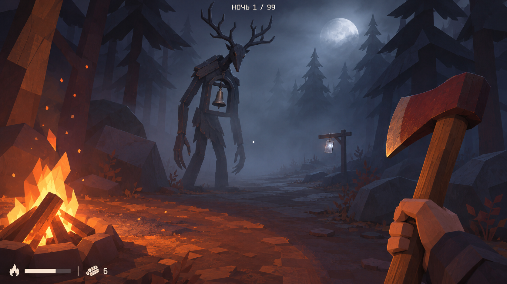

# BellDeer

Одиночный 3D survival-horror для браузера. Днём игрок рубит дрова и готовит лагерь. Ночью за границей света ходит Звонарь — деревянный зверь с колоколом в груди. Чтобы забрать лесную бирку, придётся оставить костёр и успеть вернуться до броска.

## Материалы для прототипа

- [Визуальное руководство для разработчика и ИИ-билдера](START-HERE.md) — пять дополнительных референсов. В них показаны дневная рубка, устройство поляны, ночная вылазка, модель Звонаря и экран выбора карт.
- [GDD и техническая спецификация](99-nights-by-the-fire-gdd.md) — управление, экономика костра, поведение Звонаря, 19 карт улучшений, интеграция CrazyGames и целевые показатели WebGL.

Первый игровой прототип охватывает путь от рубки первого дерева до возвращения из ночной вылазки и выбора карты на рассвете. Текущая публикация содержит документацию и концепт-арт для его разработки.
